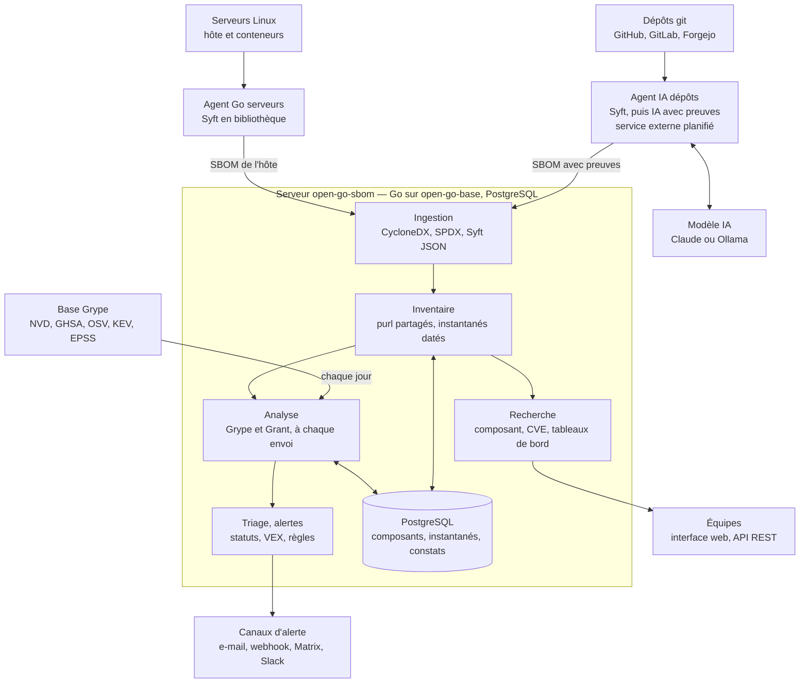

# Cahier des charges — open-go-sbom

Version 0.2 du 31 octobre 2026 · copie du [document de travail](https://claude.ai/artifact/MbKyXZtq2r6j9oZqf1GMwS), qui reste la version de référence pour les commentaires.

open-go-sbom collecte les SBOM des dépôts git (agent IA) et des serveurs (agent Go), les centralise et les réanalyse chaque jour. Ce brouillon v0.2 fixe le besoin et une architecture tout en Go ; dix décisions sont prises et quatre points restent ouverts (section 12).

## 1. Contexte et objectifs

open-go-sbom tient à jour l'inventaire logiciel (SBOM) de chaque projet — dépôt git ou serveur — et en surveille les vulnérabilités en continu, depuis un serveur central unique.

Aujourd'hui, répondre à « sommes-nous touchés par cette CVE ? » ou « où tourne encore telle version de cette bibliothèque ? » demande de fouiller chaque dépôt et chaque machine. Le [Cyber Resilience Act](https://digital-strategy.ec.europa.eu/en/policies/cyber-resilience-act) européen rend cette réponse obligatoire pour les fabricants de produits numériques : signalement des vulnérabilités activement exploitées depuis le 11 septembre 2026, SBOM exigé avec les obligations principales au 11 décembre 2027.

**Objectifs**

1. Produire un SBOM à jour pour chaque projet : par un agent IA pour les dépôts git, par un agent Go non IA pour les serveurs.
2. Centraliser ces SBOM sur un serveur qui les normalise et en garde l'historique.
3. Réanalyser chaque jour toutes les SBOM stockées contre les bases de vulnérabilités, sans attendre un nouvel envoi des agents.
4. Retrouver en quelques secondes les projets qui utilisent un composant, une version, une plage de versions ou qui sont touchés par une CVE.
5. Offrir un tableau de bord de la posture de sécurité, global et par projet.

**Cibles proposées (à valider)**

- Alerte émise moins de 24 h après l'arrivée d'une CVE dans la base de vulnérabilités.
- Recherche par composant en moins de 2 s sur 1 000 projets et 1 million de composants.
- Agent serveur : un binaire statique, moins de 5 % d'un cœur CPU en moyenne sur la durée d'un scan.

## 2. État de l'art et positionnement

Oui, le serveur existe déjà en open source : OWASP Dependency-Track couvre l'ingestion de SBOM par projet, l'analyse continue, le tableau de bord et la recherche transverse. Aucun outil ne couvre en revanche la collecte : générer les SBOM des dépôts et des serveurs, puis les pousser.

| Outil | Ce qu'il couvre | Ce qui manque pour ce besoin |
| --- | --- | --- |
| [Dependency-Track 5](https://owasp.github.io/blog/2026/06/09/dependency-track-v5.html) (OWASP) | Analyse continue de SBOM par projet et version, tableau de bord, recherche de composants et des projets touchés par une CVE, politiques en CEL, PostgreSQL et haute disponibilité depuis la 5.0 (juin 2026). Catalogues KEV de la CISA et de l'ENISA et ingestion CycloneDX 1.7 depuis la [5.1](https://dependencytrack.org/news/dependency-track-5-1) (31 août 2026). | Aucun agent de collecte. Ingestion CycloneDX seule dans ses annonces. Un serveur n'y est qu'un projet générique, sans signal de vie d'agent ni contexte d'hôte. Socle Java. |
| [GUAC](https://github.com/guacsec/guac) (OpenSSF) | Graphe qui relie SBOM CycloneDX et SPDX, attestations SLSA et in-toto, OSV, Scorecard, VEX ; API GraphQL et REST. | Pas de tableau de bord ni de triage. Projet en incubation. |
| [SecObserve](https://github.com/MaibornWolff/SecObserve) | Gestion des vulnérabilités et des licences à partir des résultats de scanners en CI, règles d'évaluation, tableau de bord. | Centré sur les constats, pas sur l'inventaire ; recherche transverse de composants non documentée. |
| [DefectDojo](https://github.com/DefectDojo/django-DefectDojo) (OWASP) | Gestion de vulnérabilités multi-scanners : dédoublonnage, remédiation, rapports. | Pas centré SBOM. SSO, LDAP et MFA réservés à l'édition Pro payante. |
| [Eclipse SW360](https://github.com/eclipse-sw360/sw360) | Catalogue de composants et conformité des licences via SPDX. | Pas de suivi de vulnérabilités annoncé. Socle Java et CouchDB. |
| [Syft, Grype, Grant](https://oss.anchore.com/docs/installation/) (Anchore) | Génération de SBOM, scan de vulnérabilités avec KEV, EPSS et score de risque, scan de licences ; outils en ligne de commande et bibliothèques Go. | Aucun serveur : la plateforme d'Anchore est l'offre commerciale Anchore Enterprise. |

**Trois façons de construire**

- **A. Agents seuls, Dependency-Track comme serveur.** Le plus rapide : la valeur ajoutée se limite aux deux agents. Contrepartie : aucun suivi des agents, aucun écran pour la preuve des composants trouvés par l'IA, et une pile Java à exploiter.
- **B. Serveur propre en Go qui embarque Syft, Grype et Grant.** Une seule pile, un seul moteur de correspondance des vulnérabilités pour agents et serveur, un modèle de données pensé pour les hôtes et pour la traçabilité IA. Contrepartie : refaire ce que Dependency-Track fait déjà (politiques, notifications, droits, triage).
- **C. B, avec agents compatibles Dependency-Track.** Les agents savent aussi pousser vers Dependency-Track ; un utilisateur peut adopter les agents sans adopter le serveur.

**Décision : option C, validée le 31 octobre 2026.** Le serveur propre se justifie par trois différences que Dependency-Track n'offre pas : hôtes et conteneurs comme citoyens de première classe, preuve et confiance des composants trouvés par l'IA, déploiement en un binaire Go. Les agents restent utilisables seuls avec Dependency-Track.

## 3. Périmètre et vocabulaire

Un projet est soit un dépôt git, soit un serveur ; chaque SBOM reçu devient un instantané daté de ce projet, et seul le dernier instantané fait foi pour l'état courant.

| Terme | Définition |
| --- | --- |
| Organisation | Espace isolé d'une instance : ses projets, équipes, jetons, politiques et fournisseur d'identité. Une instance en héberge plusieurs. |
| Projet | Unité suivie : un dépôt git ou un serveur ; chaque conteneur d'un serveur en est un projet enfant. Porte un nom, un type, une équipe propriétaire et des étiquettes (environnement, criticité, client). |
| Référence suivie | Pour un dépôt : une branche ou un tag suivi (`main`, `release/2.x`). Pour un serveur : l'hôte lui-même. Un dépôt peut suivre plusieurs références. |
| Agent | Programme qui produit le SBOM d'un projet et l'envoie au serveur : agent IA (dépôts) ou agent Go (serveurs). |
| SBOM | Inventaire des composants au format CycloneDX ou SPDX. |
| Instantané | Un SBOM reçu pour une référence suivie, avec son contexte : commit, date, agent, version de l'agent. Les instantanés passés servent à l'historique et aux différences. |
| Composant | Paquet identifié par son purl (`pkg:npm/lodash@4.17.21`), avec version, licences, empreintes et CPE éventuel. |
| Vulnérabilité | Entrée CVE, GHSA ou OSV, avec sévérité CVSS, score EPSS et présence au catalogue KEV de la CISA. |
| Constat | Couple composant × vulnérabilité dans un projet, porteur d'un statut de triage. |

**Hors périmètre de la première version**

- Analyse des images de conteneurs dans un registre (les conteneurs qui tournent sur un serveur suivi, eux, sont couverts).
- Correction automatique : ouverture de demandes de fusion pour monter les versions.
- Analyse statique du code (SAST) et détection de secrets.
- Inventaires matériels (HBOM) et de modèles d'IA (AI-BOM).

## 4. Architecture générale

Deux agents envoient leurs SBOM à une API d'ingestion unique ; le serveur analyse chaque envoi, puis réanalyse tout le parc chaque jour quand la base Grype change.

L'agent IA tourne hors de la CI des projets, sur la machine du serveur ou sur une machine dédiée. Les agents ne parlent qu'à l'API d'ingestion, en HTTPS avec un jeton par agent. Dans l'option C, les mêmes agents savent aussi envoyer leurs SBOM à Dependency-Track.

## 5. Agent IA pour les dépôts git

L'agent IA part d'un SBOM produit de façon déterministe par Syft, puis comble ce que les manifestes ne déclarent pas ; chaque composant ajouté par l'IA porte sa preuve et son origine, pour qu'aucune version ne soit inventée.

**Ce que l'IA apporte à Syft.** Syft lit les manifestes et les fichiers de verrouillage. L'IA vise la longue traîne :

- bibliothèques copiées dans le dépôt sans manifeste (JavaScript minifié, code C ou PHP recopié) ;
- dépendances déclarées hors gestionnaire de paquets : images de base des Dockerfile, outils installés par script, ressources chargées depuis un CDN dans les gabarits, sous-modules ;
- tri entre dépendances de développement et composants réellement livrés, notamment dans un monorepo ;
- métadonnées manquantes : licence, fournisseur, purl.

**Déroulement d'une analyse**

1. Récupérer le dépôt sur la référence suivie, à un commit précis.
2. Lancer Syft sur le répertoire : SBOM de base.
3. Laisser l'IA explorer le dépôt avec des outils en lecture seule (lister, lire, chercher) et proposer des composants candidats.
4. Exiger pour chaque candidat une preuve : fichier, ligne, extrait. Un vérificateur déterministe relit la preuve et rejette le candidat si le nom ou la version n'y figurent pas.
5. Fusionner Syft et candidats validés, dédoublonnés par purl ; noter l'origine (`syft` ou `ia`) et la confiance dans le champ `evidence` et les propriétés CycloneDX.
6. Envoyer au serveur avec le contexte : dépôt, branche, commit, version de l'agent, modèle utilisé.

**Exigences**

- Service externe aux projets, sur la machine du serveur ou une machine dédiée : il clone lui-même les dépôts déclarés, selon un calendrier ou sur les webhooks de push des forges (GitHub, GitLab, Forgejo). Accès par une application installée sur la forge, en lecture seule : GitHub App sur GitHub ; sur GitLab et Forgejo, qui n'ont pas d'équivalent, un compte de service au niveau du groupe ou de l'organisation. Elle fournit aussi les webhooks et le droit de publier les statuts de commit ; ses secrets sont chiffrés au repos.
- Fournisseur de modèle configurable : API Claude ou modèle local (Ollama) pour le code qui ne doit pas sortir de l'organisation.
- Repli sans IA : sans modèle configuré ou en cas d'erreur, l'agent envoie le SBOM Syft seul et le signale.
- Coût borné : budget de jetons par analyse ; l'IA ne relit que les fichiers modifiés depuis le dernier instantané.
- Contenu du dépôt traité comme non fiable (injection d'instructions) : outils en lecture seule, sortie contrainte à un schéma, aucune exécution du code du dépôt, aucun script d'installation lancé.
- Fichiers sensibles exclus de ce qui part vers le modèle : `.env`, clés, motifs configurables.

## 6. Agent serveur en Go

L'agent serveur est un binaire Go statique qui embarque Syft comme bibliothèque, inventorie la machine et ses conteneurs, et n'envoie un SBOM au serveur que lorsque l'inventaire a changé.

**Ce qu'il collecte**

- Paquets du système : dpkg, rpm, apk.
- Paquets de langages installés hors système : Python, Ruby, Node.js, archives Java, binaires Go et Rust.
- Contexte de l'hôte : distribution, version du noyau, architecture, nom d'hôte.
- Conteneurs en cours d'exécution (Docker, Podman, containerd) : chacun devient un projet enfant du projet de l'hôte, avec son propre SBOM ; un conteneur disparu depuis N jours voit son projet enfant archivé.
- Exclusions configurables : `/proc`, `/sys`, montages réseau, répertoires de données volumineux.

**Fonctionnement**

1. Inscription : l'agent présente un jeton d'inscription, reçoit une identité propre, et le projet serveur est créé à son premier contact avec les étiquettes de sa configuration.
2. Scan planifié : timer systemd ou démon avec intervalle (par défaut une fois par jour), plus un scan à la demande depuis le serveur.
3. Envoi conditionnel : le SBOM part seulement si son empreinte a changé ; sinon un simple signal de vie met à jour la date de dernière analyse.

**Exigences**

- Linux amd64 et arm64 en premier ; Windows plus tard.
- Aucune dépendance à l'exécution, paquets deb et rpm signés.
- Sobriété : priorité basse (nice, ionice), plafond mémoire, durée maximale de scan.
- Moindre privilège : utilisateur dédié avec la capacité `CAP_DAC_READ_SEARCH` plutôt que root ; aucune écriture hors de son répertoire.
- Réseau : HTTPS sortant uniquement, proxy, autorité de certification privée, mTLS en option.
- Mode hors ligne : écriture du SBOM dans un fichier, pour les réseaux isolés.
- Aucune IA : résultat déterministe, rien d'autre ne sort que le SBOM et le contexte de l'hôte.

## 7. Serveur central

Le serveur reçoit les SBOM, les range dans un inventaire unique indexé par purl, et relance chaque jour Grype sur le dernier instantané de chaque projet après la mise à jour de sa base.

**Ingestion**

- API REST authentifiée par jeton d'agent ; création automatique du projet à la première réception si le jeton l'autorise.
- Formats acceptés : CycloneDX JSON 1.5 à 1.7, SPDX JSON 2.3, Syft JSON. Format pivot interne : CycloneDX.
- Validation du schéma, taille maximale configurable, traitement asynchrone : réponse 202 avec un identifiant de traitement à interroger.
- Point d'envoi compatible avec celui de Dependency-Track, pour l'option C.

**Inventaire et historique**

- Les vulnérabilités sont stockées une fois pour toute l'instance ; les composants sont propres à chaque organisation, pour qu'aucun nom de paquet privé ni aucune empreinte de fichier interne ne soit partagé. Deux instantanés au même inventaire partagent le même ensemble de composants.
- Un instantané relie un projet à ses composants, avec commit, date, agent et version d'agent ; le SBOM brut est conservé pour l'audit et l'export.
- Différence entre deux instantanés : composants ajoutés, retirés, montés ou descendus de version.
- Rétention configurable des instantanés anciens.

**Analyse de sécurité**

- Grype utilisé comme bibliothèque : à chaque nouvel instantané, puis chaque jour sur tous les derniers instantanés.
- Pour chaque constat : CVSS, EPSS, présence au catalogue KEV, score de risque Grype de 0 à 100, versions corrigées ; date de première détection et de disparition.
- Licences analysées par Grant, confrontées à une liste de licences autorisées et interdites.
- Projets dont l'agent n'a rien envoyé depuis N jours signalés comme périmés.

**Triage et VEX**

- Statuts : à analyser, affecté, non affecté (avec justification VEX), faux positif, risque accepté jusqu'à une date, corrigé.
- Décision prise pour un projet ou pour tous les projets de l'organisation qui partagent le composant.
- Export OpenVEX et CycloneDX VEX ; import des VEX publiés par les éditeurs ; décisions réinjectées dans Grype pour ne plus remonter.

**Politiques et alertes**

- Règles déclaratives, par exemple : vulnérabilité KEV sur un projet de production ; critique avec correctif disponible depuis plus de 30 jours ; licence AGPL dans un produit distribué ; agent muet depuis 7 jours.
- Canaux : e-mail, webhook générique, Matrix, Mattermost, Slack ; résumé quotidien ou alerte immédiate selon la règle.
- Statut de commit : le verdict des politiques est publié sur la forge (GitHub, GitLab, Forgejo) une fois l'analyse d'un commit terminée.

## 8. Tableau de bord et recherche

La recherche répond aux trois questions qui motivent l'outil : qui utilise ce composant, qui est touché par cette CVE, et qu'est-ce qui a changé.

| Question | Exemple de saisie | Résultat |
| --- | --- | --- |
| Composant, toutes versions | `log4j-core` | Projets, versions présentes, références suivies |
| Version ou plage de versions | `pkg:npm/lodash` avec `vers:npm/<4.17.21` | Projets dont la version tombe dans la plage, comparée selon les règles de l'écosystème (npm, Maven, PEP 440, Debian) |
| Vulnérabilité | `CVE-2021-44228` | Projets touchés, statut de triage, version corrigée |
| Licence | `AGPL-3.0-only` | Projets et composants concernés |
| Empreinte | SHA-256 d'un fichier | Composants correspondants |
| À une date passée | composant + date | Projets qui l'utilisaient à cette date, d'après l'historique des instantanés |

Toutes les recherches se combinent avec des filtres (type de projet, étiquette, équipe, origine `syft` ou `ia`, KEV, sévérité) et existent à l'identique dans l'API REST ; elles ne sortent jamais de l'organisation de l'utilisateur.

**Tableaux de bord**

- Global : constats ouverts par sévérité, vulnérabilités KEV ouvertes, tendance sur 90 jours, projets les plus exposés, composants vulnérables les plus répandus, agents muets, délai médian de correction par sévérité.
- Projet : dernier instantané et son âge, constats, licences, différence avec l'instantané précédent, historique ; pour un serveur, l'agrégat de ses projets enfants.
- Composant : projets qui l'utilisent, dispersion des versions dans le parc, vulnérabilités par version.

**Exports** : résultats de recherche en CSV et JSON, SBOM d'un projet en CycloneDX ou SPDX, VEX d'un projet.

## 9. Exigences non fonctionnelles

L'outil centralise la carte des faiblesses de chaque organisation hébergée : sa propre sécurité passe avant les fonctions, et la v1 inclut le SSO et l'isolement entre organisations.

**Sécurité**

- Authentification : SSO OIDC, ou compte local avec double authentification TOTP obligatoire ; un compte local n'ouvre aucune session tant que son second facteur n'est pas enrôlé. Avec OIDC, la double authentification est déléguée au fournisseur d'identité.
- Multi-organisation dès la v1 : projets, équipes, jetons, politiques et fournisseur OIDC propres à chaque organisation ; toute requête est filtrée par organisation. À l'intérieur, droits par équipe : lecteur, analyste (trie les constats), administrateur.
- Jetons d'agent : un par agent, limités à l'envoi pour leurs projets, révocables, stockés hachés.
- Journal d'audit : décisions de triage, changements de politique, création et révocation de jetons.
- TLS partout ; clés d'API des modèles jamais stockées en clair ; CSRF, limitation de débit et échec de connexion générique fournis par open-go-base.
- La plateforme publie son propre SBOM et se surveille elle-même.

**Internationalisation**

- Système de traduction dès le premier écran : aucune chaîne en dur dans les gabarits ni dans le code.
- Clés en anglais structurées `écran.élément` : le libellé « Email » de la page de connexion devient `login.email`.
- Segments transverses sous leurs propres racines, jamais dupliqués écran par écran : `format.*` (dates, durées), `status.*` (triage), `severity.*`, `validation.*`.
- Texte produit côté serveur (notifications, rapports, erreurs d'API) : le traducteur est injecté, ou une clé est renvoyée et résolue par le gabarit ; aucune concaténation de fragments.
- Le JavaScript reçoit ses libellés déjà traduits via des attributs `data-`.
- Langues livrées en v1 : français et anglais.

**Volumétrie et performance (cibles à valider)**

- 1 000 projets, 1 million de liens composant-projet, 50 SBOM reçus par minute en pointe.
- SBOM de 5 000 composants ingéré et analysé en moins de 30 s.
- Recherche en moins de 2 s sur ce volume.

**Exploitation**

- Un binaire serveur et PostgreSQL ; image de conteneur et paquets deb et rpm, distribués sous WTFPL avec les licences et avis Apache-2.0 de Syft, Grype et Grant.
- Base de vulnérabilités Grype mise à jour en ligne, ou importée à la main sur les sites isolés.
- Métriques Prometheus, sondes de vie et de disponibilité, journaux JSON structurés.
- Migrations de schéma automatiques au démarrage ; sauvegarde = sauvegarde PostgreSQL.
- Interface conforme au RGAA (WCAG 2.1 niveau AA).

## 10. Choix techniques proposés

Tout en Go, sur le socle open-go-base et PostgreSQL seul : Syft, Grype et Grant s'importent comme bibliothèques, et le volume visé ne demande ni file de messages ni moteur de recherche séparé.

| Brique | Choix proposé | Raison |
| --- | --- | --- |
| Socle du serveur | leblanc.io/open-go-base : configuration par fichier YAML ou variables d'environnement, journaux, i18n, CSRF, limitation de débit, CORS, comptes, sessions, TOTP | Socle commun aux applications open-go : open-go-sbom n'écrit que son métier. |
| Serveur et agent serveur | Go, binaires statiques | Syft, Grype et Grant sont des bibliothèques Go : agents et serveur partagent le même code d'analyse. |
| Agent IA | Go, boucle d'agent avec outils en lecture seule ; fournisseur de modèle derrière une interface | Même langage que le reste ; changer de fournisseur ne touche pas la logique. |
| Décodage des SBOM | Décodeurs de formats de Syft (CycloneDX, SPDX, Syft JSON) | Le modèle obtenu alimente Grype directement, sans conversion maison. |
| Base de données | PostgreSQL 16 ou plus | Index sur purl et versions, recherche approchée par trigrammes (`pg_trgm`). |
| File de traitements | Table PostgreSQL lue avec `FOR UPDATE SKIP LOCKED` | Aucun courtier de messages à exploiter. |
| Interface | Rendu serveur `html/template`, JavaScript léger en amélioration progressive, CSS natif imbriqué | Pas de chaîne de construction front ; traduction résolue côté serveur ; accessibilité plus simple à tenir. |
| Traduction | i18n d'open-go-base (go-i18n), un fichier YAML par langue embarqué dans le binaire | Clés anglaises `écran.élément`, pluriels gérés, langue choisie par `?lang=` puis `Accept-Language`. |
| API | REST décrite en OpenAPI | Clients générés pour les agents et les scripts. |
| Authentification | Comptes locaux, sessions et TOTP par authx et mfax d'open-go-base ; OIDC à ajouter | TOTP obligatoire hors SSO ; SSO dans la version open source, un fournisseur d'identité par organisation. |

## 11. Lotissement

Trois lots livrés dans l'ordre : le premier, sans IA, rend déjà l'outil utile en répondant à « qui est touché par cette CVE ? ». Un lot ne démarre qu'une fois le critère du précédent atteint.

| Lot | Contenu | Critère de passage |
| --- | --- | --- |
| Lot 1 · MVP inventaire | Agent serveur Linux ; agent dépôt en mode Syft seul ; ingestion CycloneDX et SPDX ; analyse Grype quotidienne ; recherche par composant et CVE ; tableau de bord FR et EN ; organisations isolées ; comptes locaux et TOTP | Parc pilote inventorié et interrogé |
| Lot 2 · IA et triage | Enrichissement IA prouvé ; conteneurs en projets enfants ; triage et VEX ; politiques et alertes ; équipes et droits ; différences d'instantanés | Aucun ajout IA sans preuve vérifiée |
| Lot 3 · Ouverture | Envoi vers Dependency-Track ; licences avec Grant ; recherche à une date passée ; agent Windows ; mode hors ligne ; SBOM signés ; SSO OIDC | v1.0 publiée et documentée |

L'agent de dépôt démarre en mode Syft seul au lot 1 : toute la chaîne est validée avant d'y ajouter l'enrichissement IA. Les organisations isolées entrent dès le lot 1 : les ajouter après coup obligerait à reprendre tout le schéma de données. Les comptes locaux avec TOTP obligatoire aussi : c'est la seule connexion possible avant le SSO OIDC, au lot 3.

## 12. Décisions et points ouverts

Dix décisions ont été prises le 31 octobre 2026 ; le modèle par défaut reste à choisir avant le lot 2.

| Sujet | Décision |
| --- | --- |
| Construction | Option C : serveur propre en Go, agents compatibles Dependency-Track |
| Licence du projet | WTFPL |
| Agent IA | Service externe aux CI, sur la machine du serveur ou sur une machine dédiée |
| Conteneurs d'un serveur | Projets enfants du projet de l'hôte |
| Organisations | Plusieurs organisations par instance dès la v1 |
| Signature des SBOM | Lot 3 |
| Accès de l'agent IA aux dépôts | Application installée sur la forge |
| Socle du serveur | leblanc.io/open-go-base |
| Connexion sans SSO | Double authentification TOTP obligatoire |
| SSO OIDC | Lot 3 |

**Points ouverts**

- [ ] Choisir le fournisseur de modèle par défaut et la règle d'envoi de code à un modèle externe, avant le lot 2.
- [ ] Développer OIDC dans open-go-sbom ou l'ajouter à open-go-base, qui ne le fournit pas encore, avant le lot 3.
- [ ] Définir l'identité d'un projet enfant : nom du conteneur, service Compose ou image.
- [ ] Confirmer les cibles de volumétrie et de performance sur un parc réel.

## Sources

Pages consultées le 31 octobre 2026.

- [OWASP Dependency-Track 5.0 Is Now Generally Available](https://owasp.github.io/blog/2026/06/09/dependency-track-v5.html) — blog OWASP, juin 2026
- [Dependency-Track 5.1](https://dependencytrack.org/news/dependency-track-5-1) — annonce de version, 31 août 2026
- [GUAC](https://github.com/guacsec/guac) — dépôt GitHub
- [SecObserve](https://github.com/MaibornWolff/SecObserve) — dépôt GitHub
- [DefectDojo](https://github.com/DefectDojo/django-DefectDojo) — dépôt GitHub
- [Eclipse SW360](https://github.com/eclipse-sw360/sw360) — dépôt GitHub
- [Documentation open source d'Anchore](https://oss.anchore.com/docs/installation/) — Syft, Grype, Grant
- [Syft](https://github.com/anchore/syft) — « CLI tool and Go library », licence Apache-2.0
- [Lire les résultats de Grype](https://oss.anchore.com/docs/guides/vulnerability/interpreting-results/) — KEV, EPSS, score de risque de 0 à 100
- [Cyber Resilience Act](https://digital-strategy.ec.europa.eu/en/policies/cyber-resilience-act) — Commission européenne, calendrier d'application
