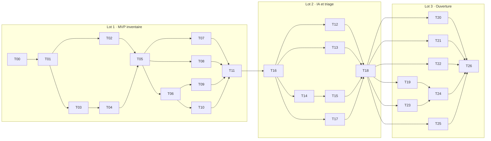

# Lots techniques

Le [cahier des charges](../docs/cahier-des-charges.md) découpe le produit en trois lots
fonctionnels. Ce dossier les décline en 27 lots techniques, chacun assez petit pour être
réalisé, relu et fusionné seul. L'[architecture de référence](architecture.md) fait autorité
sur les choix techniques ; une fiche de lot précise le quoi et le comment d'une étape.

## Façon de travailler

1. Lire `CLAUDE.md`, [`architecture.md`](architecture.md), [`lecons.md`](lecons.md), la
   fiche du lot et la section « Journal » des lots dont il dépend.
2. Vérifier que ces lots sont au statut « Terminé ».
3. Proposer un plan court. Toute nouvelle dépendance tierce, tout écart à l'architecture et
   tout point « à trancher » de la fiche sont soumis à l'utilisateur avant d'écrire du code.
4. Travailler sur une branche `lot/<id>-<sujet>` (par exemple `lot/T05-ingestion`), en
   commits atomiques, la pousser, ouvrir une PR vers `main` et la fusionner dès que la CI
   est verte et les critères cochés ; l'utilisateur relit a posteriori.
5. Écrire le test d'une règle métier avant ou avec son code, jamais après coup.
6. Cocher les critères d'acceptation, remplir le Journal de la fiche (décisions, écarts,
   ADR créés) et mettre à jour le statut dans le tableau ci-dessous, dans la même demande
   de fusion.

## Définition de « terminé », valable pour tous les lots

- `make ci` vert en local et en CI.
- Critères d'acceptation de la fiche tous cochés, ou écart expliqué dans le Journal et
  accepté par l'utilisateur.
- Tests unitaires et d'intégration pour chaque règle métier ; tests d'isolement entre
  organisations pour toute nouvelle route ou requête d'organisation.
- Toute nouvelle table d'organisation : `org_id`, clés étrangères composites, RLS forcée
  avec la politique standard, accès par `InOrg`, et ses cas ajoutés aux tests SQL de RLS.
  Toute nouvelle fonction de `crossorg` est justifiée dans le Journal et relue comme un
  changement de sécurité.
- Aucune chaîne visible en dur ; clés présentes en anglais et en français.
- Écrans : HTML sémantique, utilisables au clavier, testés en thème clair et sombre.
- Migrations nouvelles uniquement, jamais de modification d'une migration publiée.
- `docs/operations.md`, `api/openapi.yaml`, `config.example.yaml` et `architecture.md`
  à jour si le lot les touche ; ADR pour toute décision structurante.
- Aucun `TODO` sans fiche de lot ou ticket qui le porte.

## Tableau des lots

| Id | Lot technique | Lot fonctionnel | Dépend de | Statut |
| --- | --- | --- | --- | --- |
| [T00](lots/T00-fondations.md) | Fondations du dépôt et outillage qualité | 1 | — | Terminé |
| [T01](lots/T01-socle-serveur.md) | Socle du serveur | 1 | T00 | Terminé |
| [T02](lots/T02-file-de-traitements.md) | File de traitements PostgreSQL | 1 | T01 | Terminé |
| [T03](lots/T03-comptes-organisations.md) | Comptes, TOTP et organisations | 1 | T01 | Terminé |
| [T04](lots/T04-projets-agents.md) | Projets, agents et jetons | 1 | T03 | Terminé |
| [T05](lots/T05-ingestion.md) | Ingestion des SBOM et inventaire | 1 | T02, T04 | Terminé |
| [T06](lots/T06-analyse-vulnerabilites.md) | Analyse de vulnérabilités | 1 | T05 | Terminé |
| [T07](lots/T07-agent-serveur.md) | Agent serveur Linux | 1 | T05 | Terminé |
| [T08](lots/T08-agent-depot.md) | Agent dépôt sans IA et forges | 1 | T05 | Terminé |
| [T09](lots/T09-recherche.md) | Recherche transverse | 1 | T06 | Terminé |
| [T10](lots/T10-tableau-de-bord.md) | Tableau de bord d'organisation | 1 | T06 | Terminé |
| [T11](lots/T11-recette-lot-1.md) | Recette du lot 1 | 1 | T07 à T10 | Terminé (v0.1.0 à publier par l'utilisateur) |
| [T16](lots/T16-equipes-droits.md) | Équipes et droits | 2 | T11 | Terminé |
| [T12](lots/T12-enrichissement-ia.md) | Enrichissement IA de l'agent dépôt | 2 | T16 | Terminé (mesure avec un vrai modèle à faire par l'utilisateur) |
| [T13](lots/T13-conteneurs.md) | Conteneurs en projets enfants | 2 | T16 | À faire |
| [T14](lots/T14-triage-vex.md) | Triage et VEX | 2 | T16 | Terminé |
| [T15](lots/T15-politiques-alertes.md) | Politiques, alertes et statuts de commit | 2 | T14 | Terminé |
| [T17](lots/T17-differences-instantanes.md) | Différences d'instantanés | 2 | T16 | Terminé |
| [T18](lots/T18-recette-lot-2.md) | Recette du lot 2 | 2 | T12 à T17 | À faire |
| [T19](lots/T19-dependency-track.md) | Compatibilité Dependency-Track | 3 | T18 | À faire |
| [T20](lots/T20-licences.md) | Licences avec Grant | 3 | T18 | À faire |
| [T21](lots/T21-recherche-historique.md) | Recherche à une date passée | 3 | T18 | À faire |
| [T22](lots/T22-agent-windows.md) | Agent serveur Windows | 3 | T18 | À faire |
| [T23](lots/T23-hors-ligne.md) | Mode hors ligne | 3 | T18 | À faire |
| [T24](lots/T24-sbom-signes.md) | SBOM signés | 3 | T19, T23 | À faire |
| [T25](lots/T25-sso-oidc.md) | SSO OIDC | 3 | T18 | À faire |
| [T26](lots/T26-publication-v1.md) | Publication de la v1.0 | 3 | T19 à T25 | À faire |

## Ordre de réalisation

Les lots d'une même colonne sans flèche entre eux peuvent avancer en parallèle, dans des
branches distinctes, à condition de ne pas toucher aux mêmes fichiers.

## Gabarit d'une fiche

Chaque fiche suit la même structure : objectif, périmètre (inclus, exclu), conception,
livrables, critères d'acceptation (cases à cocher), tests attendus, points à trancher avec
l'utilisateur, et un Journal rempli pendant la réalisation.
